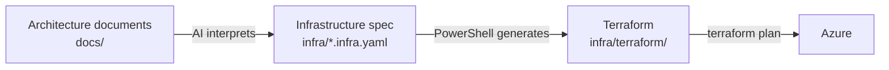

# Automated Terraform Generator Demo

This repository is the demo for the conference session *[From Architecture to Terraform: Letting AI Do the Boring Parts](https://www.chadgreen.com/presentations/from-architecture-to-terraform/)*. You will take an approved architecture for a backend service, let AI turn it into a structured infrastructure specification, and then use a small PowerShell generator to turn that specification into plain Terraform. At the end, you will run `terraform init`, `validate`, and `plan` against the result.

The service is the Work Item Service, a shared backend that product applications at the fictional Momentum Rocket Skates call to create, assign, and complete work items. When something is assigned or completed, an event processor sends notifications and records an audit entry in the background. It runs on Azure Container Apps, Azure Functions, Service Bus, Cosmos DB, App Configuration, Key Vault, and Application Insights.

The idea behind the workflow is to split the work by what each tool is good at:



AI does the fuzzy work: reading human-written documents and deciding what they mean. A script does the deterministic work: the same specification always produces byte-identical Terraform. Engineers review the spec, the Terraform, and the plan.

## What is in this repository

| Path                        | Description                                                  |
| --------------------------- | ------------------------------------------------------------ |
| `.claude/skills`            | The Claude Code skill that turns the architecture into a specification. |
| `.github/prompts`           | The GitHub Copilot prompt that turns the architecture into a specification. |
| `docs/`                     | The approved architecture documents for the Work Item Service. |
| `guides/`                   | Extra guides for this demo that help you adopt what is shown here to your service and how to extend the generator. |
| `tools/terraform-generator` | The PowerShell generator, its schema, tests, and a reference example. |
| `infra/`                    | Created by you in step 2 (the specification) and step 3 (the Terraform) |

## What you need

| Requirement                                                  | Notes                                                        |
| ------------------------------------------------------------ | ------------------------------------------------------------ |
| [PowerShell 7 (`pwsh`)](https://learn.microsoft.com/en-us/powershell/scripting/install/install-powershell) | The generator does not run on Windows PowerShell 5.1.        |
| The [`powershell-yaml` module](https://www.powershellgallery.com/packages/powershell-yaml) | `Install-Module powershell-yaml -Scope CurrentUser`          |
| An AI coding assistant: [GitHub Copilot](https://github.com/features/copilot) or [Claude Code](https://claude.com/product/claude-code) | Step 2 uses one of them, whichever you have. Without either, you can still do steps 3 and 4 (see step 2). |
| [Terraform 1.6 or later](https://developer.hashicorp.com/terraform/install) | OpenTofu should also work for the Terraform steps.           |
| [TFLint](https://github.com/terraform-linters/tflint)        | Used for the lint check in step 4.                           |
| [Azure CLI](https://learn.microsoft.com/en-us/cli/azure/install-azure-cli?view=azure-cli-latest) and an Azure subscription | `terraform plan` needs credentials. Nothing is created in Azure. |

## Get the repository

Clone it and open the folder:

```powershell
git clone https://github.com/TaleLearnCode/AutomatedTerraformGeneratorDemo.git
cd AutomatedTerraformGeneratorDemo
```

Run every command in this guide from the root of the cloned repository, and open that same folder in Visual Studio Code or Claude Code so the prompt and skill are found.

## Step 1: Read the architecture

Open the `docs` folder. These are the documents an architecture team would hand over once a service is approved:

| Document                                                     | What it tells you                                   |
| ------------------------------------------------------------ | --------------------------------------------------- |
| [`executive-summary.md`](./docs/executive-summary.md)        | Why the service exists and what it costs.           |
| [`architecture-guide.md`](./docs/architecture-guide.md)      | The principles and decisions behind the design.     |
| [`system-context.md`](./docs/system-context.md)              | What the service talks to and the pieces inside it. |
| [`process-flow-work-item-creation-and-assignment.md`](./docs/process-flow-work-item-creation-and-assignment.md) | How a work item moves through the system.           |
| [`architecture-specifications.md`](./docs/architecture-specifications.md) | The obligations, interfaces, and quality targets.   |
| [`infrastructure-architecture-guide.md`](./docs/infrastructure-architecture-guide.md) | The Azure infrastructure, in plain language.        |

The one to read closely is `infrastructure-architecture-guide.md`. Notice how much it already says, and how it says it:

- **Section 5.1** maps each part of the service to an infrastructure resource, with the resource type to use in the spec.
- **Section 6** lists numbered obligations (IG-001 to IG-022) and the baseline settings for each resource.
- **Section 6.7** defines the naming pattern and the tags.
- **Section 7** lists the only differences between `dev`, `qa`, and `prd`.

A person can read this document, and so can an AI. Nothing in it is written for a machine, and it still contains everything a build needs.

## Step 2: AI to YAML

This repository sets up the same task for two AI coding assistants. Use whichever you have:

| Assistant                                 | Where the instructions live                                  | How to run it                 |
| ----------------------------------------- | ------------------------------------------------------------ | ----------------------------- |
| GitHub Copilot Chat in Visual Studio Code | [`.github/prompts/create-infrastructure-spec.prompt.md`](.github/prompts/create-infrastructure-spec.prompt.md) | `/create-infrastructure-spec` |
| Claude Code                               | [`.claude/skills/create-infrastructure-spec/SKILL.md`](.claude/skills/create-infrastructure-spec/SKILL.md) | `/create-infrastructure-spec` |

Both carry the same instructions. They tell the AI to read the Infrastructure Architecture Guide and the generator's spec reference and schema, and to write a spec that follows the schema.

**GitHub Copilot (using the VS Code Chat Window)**

1. Open this folder in Visual Studio Code.

2. Open Copilot Chat, switch to agent mode, and choose a model. The original demo uses a Claude model.

3. Run the prompt:

   ```
   /create-infrastructure-spec
   ```

**Claude Code**

1. Open a terminal in the root of this repository and start Claude Code:

   ```powershell
   claude
   ```

2. Run the skill:

   ```
   /create-infrastructure-spec
   ```

3. Approve the file write when Claude Code asks.

With either tool, wait for it to finish. It writes `infra/<service-name>.infra.yaml`, where the service name comes from the architecture documents (here, `work-item-service`).

The reply ends with a table tracing each part of the architecture to a spec entry, a list of assumptions the AI had to make, and a list of questions for a human. Read the assumptions and questions first. They are the places where a person needs to look.

Then open the spec. Each resource has a comment naming the architecture section or obligation it came from, and the values that differ per environment look like `min_replicas: { dev: 0, qa: 1, prd: 2 }`. Compare a few of them against section 7 of the guide.

AI output varies from run to run, so your spec will not be identical to anyone else's. What stays constant is the structure, because the schema constrains it, and the review step: nothing is built until a person has read the spec.

**No AI assistant?** Copy the reference spec into place and continue with step 3:

```powershell
New-Item -ItemType Directory -Path .\infra -Force
Copy-Item .\tools\terraform-generator\examples\work-item-service\work-item-service.infra.yaml .\infra\
```

## Step 3: YAML to Terraform

The generator reads the spec and writes Terraform. There is no AI in this step.

```powershell
.\tools\terraform-generator\New-TerraformConfiguration.ps1 -SpecPath .\infra\work-item-service.infra.yaml -OutputPath .\infra\terraform
```

Use the file name that appears in your `infra` folder if it differs. The generator checks the spec first and stops with a clear message if something is wrong, such as a misspelled field or a reference to a topic that does not exist. You will see a warning about placeholder remote-state values. That is expected: the architecture leaves the state location to the platform team.

It writes these files to `infra/terraform`:

| File                             | Contents                                                     |
| -------------------------------- | ------------------------------------------------------------ |
| `providers.tf`                   | Terraform and azurerm provider settings, and an empty `azurerm` backend. |
| `variables.tf`                   | The `environment` variable and one variable per environment-specific value. |
| `locals.tf`                      | The naming pattern, tags and every resource name.            |
| `main.tf`                        | The resources, role assignments and diagnostic settings.     |
| `outputs.tf`                     | Names, URLs and endpoints.                                   |
| `environments/<env>.tfvars`      | Each environment's values.                                   |
| `environments/<env>.backend.hcl` | Each environment's remote state settings.                    |

Open `main.tf` and look for the facts the architecture asked for. Local authentication is disabled on Service Bus, App Configuration and Cosmos DB. Both workloads use managed identities with only the role assignments the guide lists. Diagnostic settings send logs to Log Analytics. None of that was typed by hand, and it comes out the same every time.

### Check that it is deterministic

Stage the output, run the generator again, and see what git thinks changed:

```powershell
git add .
.\tools\terraform-generator\New-TerraformConfiguration.ps1 -SpecPath .\infra\work-item-service.infra.yaml -OutputPath .\infra\terraform
git status --short
```

Every file shows as newly added and none as modified. The same spec gives byte-identical Terraform. In a pipeline, that means a diff only ever reflects a real change to the spec.

## Step 4: Check the Terraform

### Remote state

In a real project, each environment's state lives in Azure storage. You would fill in the values in `environments/dev.backend.hcl` and initialize with:

```powershell
terraform init -backend-config=environments/dev.backend.hcl
```

For this walkthrough, switch to local state instead. A Terraform override file replaces the backend without changing the generated files. This file is for the walkthrough only.

```powershell
Set-Content -Path .\infra\terraform\backend_override.tf -Value 'terraform {', '  backend "local" {}', '}'
```

### Credentials

`terraform plan` reads from Azure but changes nothing. Sign in and tell Terraform which subscription to use:

```powershell
az login
$env:ARM_SUBSCRIPTION_ID = "<subscription id>"
```

### Initialize, validate, lint and plan

```powershell
cd .\infra\terraform
```

```powershell
terraform init
```

```powershell
terraform validate
```

```powershell
tflint
```

```powershell
terraform plan -var-file=environments/dev.tfvars
```

`init` should finish with "Terraform has been successfully initialized!" and `validate` with "Success! The configuration is valid." `tflint` checks for lint problems, so read anything it reports. The plan should end with something like **Plan: 32 to add, 0 to change, 0 to destroy.** The exact number follows your spec. Try `-var-file=environments/prd.tfvars` and compare what changes between environments.

This walkthrough stops at the plan. Applying it would create real, billable Azure resources, and it also needs a real remote state location. Before you apply anything, confirm the provider arguments listed in the [generator README](tools/terraform-generator/README.md#provider-arguments-to-confirm).

## Going further

| If you want to                                     | Read                                                         |
| -------------------------------------------------- | ------------------------------------------------------------ |
| Apply this approach to your own service            | [Adapting this to your service](guides/adapting-to-your-service.md) |
| Add a resource type the generator does not support | [Extending the generator](guides/extending-the-generator.md) |
| Write or change a spec by hand                     | [Infrastructure spec reference](tools/terraform-generator/docs/infra-spec-reference.md) |
| Understand how the generator is organized          | [Generator README](tools/terraform-generator/README.md)      |
| Run the generator's checks                         | `.\tools\terraform-generator\tests\Test-Generator.ps1`       |

## If something goes wrong

| Problem                                                      | Fix                                                          |
| ------------------------------------------------------------ | ------------------------------------------------------------ |
| The generator says it needs PowerShell 7                     | Run it from a `pwsh` terminal.                               |
| `ConvertFrom-Yaml` is not recognized                         | Install the module: `Install-Module powershell-yaml -Scope CurrentUser` |
| `/create-infrastructure-spec` is not in the list in Copilot Chat | Make sure the folder you opened in VS Code is this repository's root, so `.github/prompts` is found. |
| `/create-infrastructure-spec` is not found in Claude Code    | Start `claude` from this repository's root, so `.claude/skills` is found. |
| The generator reports problems with the spec                 | Read the list. Each line names the resource and the field. Fix the spec and run the generator again. |
| `terraform init` asks for backend settings                   | `backend_override.tf` is missing or is not in `infra/terraform`. |
| `terraform init` says the backend changed                    | Run `terraform init -reconfigure`.                           |
| `terraform plan` fails on credentials                        | Run `az login` and set `ARM_SUBSCRIPTION_ID` in the same terminal. |
| You want to run the demo again from the start                | Delete what you created: `Remove-Item .\infra -Recurse -Force`. Everything else in the repository is untouched. |
